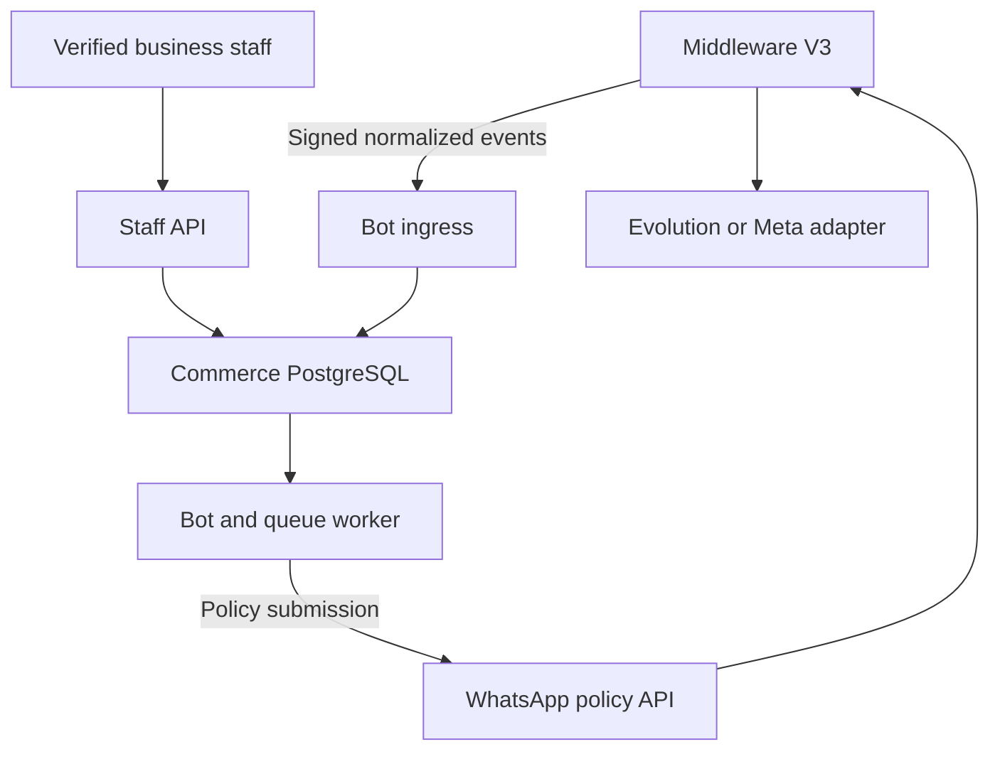

# Codestra WhatsApp Commerce Bot

Python/PostgreSQL commerce service for independent businesses using Codestra's WhatsApp platform. This repository contains the staff API, a guided English/Spanish bot, durable message processing, transactional ordering, operator commands, and integration tests.

**Delivery is disabled by default.** The bot submits approved messages through the existing WhatsApp policy API and Middleware V3. It has no direct Meta or Evolution sending client. This source implementation does not install a production database or activate a business number. The sibling-service integration gates are recorded in [the integration contract](docs/integration-contract.md).

The reviewed design originates in [WhatsApp PR #23](https://github.com/appolon1908/WhatsApp/pull/23); its source snapshot is in [the architecture document](docs/architecture/commerce-platform.md).

## What is implemented

| Area | Behavior |
| --- | --- |
| Businesses and access | Separate business settings and persisted staff memberships; verified RS256 identity; owner, supervisor, assigned-agent and fulfillment permissions. |
| Catalog and inventory | Products, integer minor-unit prices, USD/DOP currencies, images, availability, stock adjustments and reservation accounting. |
| Checkout | Durable carts, delivery zones/minimums/fees, pickup, opening hours, explicit tax basis points, expiring quotes and idempotent order confirmation. |
| Order operations | Acceptance/rejection, preparation, dispatch, delivery/collection, cancellation, reservation expiry and audited external payment/refund records. |
| Conversations | Persisted inbound/outbound history, assignment, consent evidence, human takeover and explicit staff resume. |
| Guided bot | Catalog browsing, cart commands, delivery/pickup checkout, confirmation and order status in English and Spanish. |
| Queues | Authenticated inbox, per-customer FIFO, duplicate-event detection, transactional outbox, stable command IDs, bounded retries, dead letters and audited replay. |
| Isolation | Dedicated PostgreSQL database and roles, FORCE row-level security on all 16 business tables, composite tenant foreign keys and transaction-local tenant context. |
| Operations | Explicit provision/migrate/onboard/register commands, liveness/readiness endpoints, queue inspection, Docker/Compose, pinned dependency lock and CI. |

The staff interface is an HTTP API with interactive documentation at `/docs`. A custom dashboard, AI conversation generation, online payment processor, and courier integration are separate integrations; the working order flow uses deterministic commands and staff-recorded fulfillment/payment updates.



## Local setup with Docker Compose

Use the dedicated development database in this Compose project. Existing controller databases are not part of this setup.

1. Copy the configuration template and generate separate credentials:

   ```bash
   cp .env.example .env
   python3 -c 'import secrets; print(secrets.token_hex(32))'
   ```

   Generate a different value for `COMMERCE_POSTGRES_ADMIN_PASSWORD`, `COMMERCE_APP_PASSWORD`, and `COMMERCE_INGRESS_SECRET`. Put the values in `.env`; do not commit that file. Configure `COMMERCE_JWT_ISSUER`, `COMMERCE_JWT_AUDIENCE` and either `COMMERCE_JWKS_URL` or `COMMERCE_JWT_PUBLIC_KEY` for your identity service. Leave outbound delivery disabled.

2. Start PostgreSQL, then explicitly provision and migrate:

   ```bash
   docker compose up -d db
   docker compose --profile operator run --rm operator provision --database codestra_whatsapp_commerce
   docker compose --profile operator run --rm operator migrate
   ```

3. Create a business with the owner's verified identity-service subject:

   ```bash
   docker compose --profile operator run --rm operator onboard-business \
     --name 'Example Store' --currency DOP --timezone America/Santo_Domingo \
     --owner-subject 'identity-provider-subject' --tax-bps 0
   ```

   Record the returned business UUID. The tax value is an explicit configuration decision; zero is only an example.

4. After independently verifying control of the business number, record its binding:

   ```bash
   docker compose --profile operator run --rm operator register-channel \
     --tenant-id BUSINESS_UUID --provider meta \
     --account-id VERIFIED_ACCOUNT_ID --phone-number-id VERIFIED_PHONE_NUMBER_ID \
     --verification-reference 'verification-record-reference' \
     --policy-campaign-id 'approved-policy-campaign'
   ```

   Registration records the operator's verification evidence. It does not contact the provider or verify ownership itself. An ordinary business token cannot register or activate a channel. Reactivating a disabled binding requires a fresh verification reference.

5. Start the API. Add the business UUID to `COMMERCE_WORKER_TENANT_IDS` as a JSON list before starting the worker:

   ```bash
   docker compose up -d api
   # .env: COMMERCE_WORKER_TENANT_IDS=["BUSINESS_UUID"]
   docker compose --profile worker up -d worker
   ```

   API: `http://127.0.0.1:8783`; development PostgreSQL: `127.0.0.1:55483`. `/healthz` reports process liveness. `/readyz` also requires the restricted database role, schema, identity configuration and a sufficient ingress secret. Configured readiness does not certify a live policy/provider connection.

## Staff API example

Every business request needs both a verified bearer token and a business selection. `X-Business-ID` selects among the token subject's active database memberships; it grants no permission by itself.

```bash
curl --fail-with-body http://127.0.0.1:8783/commerce/v1/products \
  -H "Authorization: Bearer $STAFF_ACCESS_TOKEN" \
  -H "X-Business-ID: $BUSINESS_ID" \
  -H 'Content-Type: application/json' \
  --data '{"sku":"JUICE","name":"Chinola juice","price_minor":15000,"currency":"DOP","stock_on_hand":25}'
```

Amounts are integer minor units: `15000` means DOP 150.00. The currency must match the business. Creating a quote does not reserve inventory; a valid confirmation reserves it atomically. Quotes last 15 minutes; unaccepted submitted reservations expire after 30 minutes. Accepted orders require an explicit terminal transition. Repricing, cart edits, changed delivery charges, changed tax, expiry or insufficient stock require a new quote.

Order confirmation uses `POST /commerce/v1/orders`, a `quote_id` body, and an `Idempotency-Key` header of 8–128 characters. Retrying the same accepted key returns its order; a key cannot be reused for a different quote. Confirmation through the guided bot uses the stable originating event identity.

Opening hours use named weekdays and increasing same-day windows, for example:

```json
{"opening_hours":{"mon":[["09:00","17:00"]],"tue":[["09:00","17:00"]],"sat":[]}}
```

The configured timezone determines the local day. Missing days in a configured schedule are closed; `opening_hours: null` removes the schedule restriction. Overnight ranges must be represented as separate supported day windows. Tax is a configured basis-point rate applied to merchandise plus delivery, with integer half-up rounding.

## Customer commands

| English | Spanish | Result |
| --- | --- | --- |
| `START` | `INICIAR` | Record explicit opt-in. |
| `MENU` / `CATALOG` | `CATALOGO` | Show available products and command help. |
| `ADD JUICE 2` | `AGREGAR JUICE 2` | Set that SKU's cart quantity. |
| `REMOVE JUICE` | `QUITAR JUICE` | Remove a product. |
| `CART` | `CARRITO` | Show the cart. |
| `CHECKOUT PICKUP` | `FINALIZAR RECOGIDA` | Quote pickup checkout. |
| `CHECKOUT DELIVERY ZONE address` | `FINALIZAR ENTREGA ZONE dirección` | Quote delivery. |
| `CONFIRM QUOTE_UUID` | `CONFIRMAR QUOTE_UUID` | Confirm a current quote and reserve stock. |
| `ORDER ORDER_UUID` | `PEDIDO ORDER_UUID` | Show an order in that conversation. |
| `HUMAN` | `HUMANO` | Switch to human handling. |
| `STOP` | `PARAR` | Opt out and invalidate queued bot replies. |

Consent is checked again at dispatch. A newer staff opt-out survives an older queued START. Human takeover blocks pending bot replies and persists until authorized staff resume the bot. A provider command already accepted before takeover cannot be recalled by this service.

## Development and verification

Python 3.12 or 3.13 and PostgreSQL 16+ are required. Install the locked development environment:

```bash
uv sync --frozen --extra dev
uv run ruff check .
uv run ruff format --check .
```

Integration tests require an explicitly disposable PostgreSQL cluster with `TEST_DATABASE_ADMIN_URL`, a `codestra_whatsapp_commerce_test...` database name, matching `pg_dump`/`pg_restore` clients, and the CI HBA rules described in [operations](docs/operations.md). There is no SQLite substitute and missing integration prerequisites fail the tests.

```bash
uv run pytest
uv build
```

The tests exercise actual RLS, pooled tenant cleanup, cross-database connection rejection, concurrent final-unit checkout, authorization and consent races, FIFO/retries, duplicate confirmations, human takeover, bounded external responses, and a real dump/restore preserving pending work and ownership. See [verification evidence](docs/implementation/verification.md) for the tested source and limits.

For a source or installed-wheel deployment, credentials come from explicit process environment variables; Python does not load `.env` automatically. Run `commerce --help` for operator commands and `commerce api` / `commerce worker` for runtime processes. The wheel includes canonical Alembic migration resources.

## Review and promotion

Source changes follow `atomic_task → subsection → section → development → testing → staging → production`. Review, required authority checks and deployment evidence apply to each promotion. CI verifies the source and isolated test runtime; it does not synthesize a controller approval or certify production backups. No deployment workflow is included.

- [Integration contract and external gates](docs/integration-contract.md)
- [Operations, recovery and access controls](docs/operations.md)
- [Implementation decisions and review ledger](docs/implementation/ledger.md)
